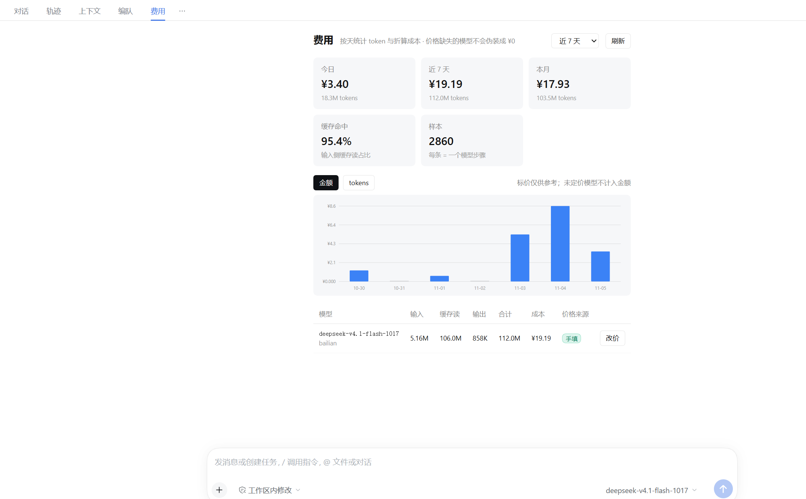

# dsh-cost-ledger


> **DSH 的「费用」标签页：按天、按模型看 token 花了多少钱。**
> 它认的不只是 DeepSeek —— 同一份权重经百炼、官方、第三方转售卖出，价格不同，它都记得准；
> 界面照着 DeepSeek 官方控制台做：按天堆叠柱状图、鼠标一悬停就看到当天明细。




---

## 它解决什么问题

大部分人不是只用官方 API。你在阿里百炼上跑模型，但市面上的用量插件几乎都只内置一份 **DeepSeek 官方价**：

- 模型名一样、**服务商不一样**，价格可能差好几倍
- 官方有峰谷时段，百炼不一定有；套错规则直接算成两倍
- 私有部署（`cmaas-*` 这种带租户前缀的模型）在任何公共价目表里都查不到

结果就是：token 统计得很准，**金额是错的，而且错得悄无声息**。

这个插件做三件事：

1. **认身份**：按 `服务商 + 模型` 二元组查价，不是按模型名瞎猜
2. **讲出处**：每一行都有置信度徽章（手填 / 官方 / 聚合目录 / 继承 / 未定价）
3. **能补价**：查不到就明说「未定价」，点一下就地填，填完历史数字立刻重算

> 宁愿显示「未定价」，也不显示一个看起来很专业的假 `¥0.00`。

## 功能

| | |
|---|---|
| 📅 **按天图表** | 天 × 模型的堆叠柱状图，悬停显示当天各模型花费，可切「金额 / tokens」 |
| 💰 **KPI 条** | 今日 / 近 N 天 / 本月 / 缓存命中率 / 样本数 |
| 🏷️ **价格来源** | 每个模型一行徽章，一眼看出这个数是查来的还是你填的 |
| ✏️ **就地补价** | 未定价横幅点开填四个单价（元 / 百万 token），保存即重算 |
| 🗂️ **随包价目** | 自带阿里百炼 **142 个模型**的官方人民币价：千问全系 + DeepSeek / Kimi / GLM / MiniMax 的百炼上架版 |
| ⏪ **历史回填** | 首次启动自动扫描 `~/.dsh/sessions/`，过去几天的账立刻就有 |
| 🧮 **可对账** | `npm run replay` 用同一份代码在终端复算，界面数字必须能复现 |

## 安装

**方式一：插件商场** —— 搜索 `cost-ledger`（完整包名 `@looriann/dsh-cost-ledger`），点击安装。

**方式二：命令行**

```bash
dsh plugin --profile desktop add @looriann/dsh-cost-ledger
```

装完**重启 DSH**，浏览器 `Ctrl+Shift+R` 硬刷新。打开任意会话，顶部标签栏会多一个「费用」。

> 依赖：Node.js `^22.19 || >=24`、DSH `0.2.0-rc.2` / `0.2.1-rc.2`。运行时**零依赖**。

## 三步用起来

1. 打开任意会话 → 点顶部 **「费用」**
2. 首次打开会自动回填历史，几秒后图表和 KPI 就有了
3. 顶部如果出现橙色横幅「有 N 个模型还没定价」→ 点里面的 chip 补价

## 价格是从哪来的

按优先级从高到低：

| 来源 | 说明 |
|---|---|
| **你手填的** | 最高优先级，永远不会被自动抓取覆盖 |
| **官方价目** | 随包种子（阿里百炼官方页，142 个模型，含第三方模型的百炼版），或 `npm run prices` 重新抓 |
| **聚合目录** | M2 计划接入 models.dev / LiteLLM |
| **继承同模型** | 同模型在别的服务商下有条目，借用但降级标注 |
| **未定价** | 只有 token 没有钱，界面明确标红 |

### 关于自动抓价，实话实说

- ❌ `bailian.console.aliyun.com` 的模型广场是**登录态 SPA**，程序抓不到表格
- ✅ 同一份表格有公开 Markdown 导出：`help.aliyun.com/zh/model-studio/model-pricing.md`，能解析出 **CNY 单价 + 阶梯区间 + 免费额度**，当前 **142 个模型**
- ✅ 而且那不只是千问：**DeepSeek、Kimi、GLM、MiniMax 在百炼上架的版本都有官方价**。比如你的 `deepseek-v4.1-flash-1017` = 2 / 8 元每百万，`kimi/kimi-k3.1-pro` = 13 / 68 元
- ❌ 真正抓不到的只有**私有部署**（`cmaas-glm-5.3` 这种带租户前缀的），它不在任何公开价目里
- ⚠️ 官方页只列输入 / 输出单价，**缓存单价不单列**；这里按百炼公开规则推算（缓存命中 10%、显式创建 125%），并在价目表里标 `cacheRule` 字段

所以设计成：能抓的抓，抓不到的**留空给你填**，绝不猜。

```bash
npm run prices     # 重新抓官方价目，合并进你的账本（不覆盖手填行）
```

## 数字为什么可信

- **token 不猜**：直接读 harness 的 `assistant/message` 事件，`input / cacheRead / cacheWrite / output` 四个分项原样落账
- **不重复计费**：以 `sessionId + turn + step` 为键，同一步骤重复上报是替换，不是累加
- **整数微元**：`micro = round(tokens × 单价)`，避免浮点误差滚雪球；`null ≠ 0`
- **读时计价**：金额永远按当前价目表现算，改价不用重建历史
- **可对账**：

```bash
npm run replay                 # 回放全部会话，打印每天的 tokens 与金额
npm run replay -- <日志文件>    # 单个会话，逐轮成本
```

`replay` 和插件跑的是**同一份 `lib/` 代码**，所以界面上的数字一定能在终端复现。

## 数据与隐私

```
~/.dsh/cost-ledger/
├─ samples.ndjson   ← 只追加的 usage 样本（唯一事实来源）
└─ prices.json      ← 你的价目表
```

- 完全本地，**不联网**（只有你手动跑 `npm run prices` 时才访问阿里云文档页）
- 不上传任何内容，不读你的对话正文（只读 usage 里的数字）
- 删掉 `samples.ndjson` 重启 = 从零重来（会自动重新回填）

## 常见问题

**Q：为什么我的模型显示「未定价」？**
A：它在公共价目表里没有对应条目，最常见的是**私有部署**（`cmaas-*` 这类带租户前缀的）。点横幅里的 chip 填一次就行，之后一直有效。

**Q：我装了旧版本，价目表还是空的？**
A：删掉 `~/.dsh/cost-ledger/prices.json` 再重启，就会重新加载随包的 142 条官方价（你的 `samples.ndjson` 不会动，历史账还在）。

**Q：和官方账单对不上？**
A：常见原因有四个——缓存读写价没填（默认按输入价保守计）、阶梯档位不同、官方免费额度没扣、四舍五入。插件显示的永远是**按你填的价目表算出来的估算**，不是账单。

**Q：会和其他用量插件冲突吗？**
A：不会。它只读 `session/event`、只注册自己的 `/api/cost-ledger/*` 路由、只在标签栏加一个页，不改任何内置组件。

**Q：为什么小额显示成 ¥0.0053？**
A：因为官方的两位小数会把一次调用显示成 `¥0.00`，看着像免费。这里小于 1 分时自动多显示几位。

## 开发

```bash
npm run check      # 语法检查（8 个模块）
npm test           # 22 项单元用例 + 8 项插件冒烟
npm run replay     # 回放本机真实日志
npm run seed       # 从抓取结果重建随包价目表
npm run rename     # 一键改包名（换 npm 作用域时用）
```

零依赖，不需要 `npm install`。设计文档与计价口径见 [DESIGN.md](DESIGN.md)，贡献方式见 [CONTRIBUTING.md](CONTRIBUTING.md)。

## 路线图

- **M1（当前）**：按天账本 + 服务商感知的价目 + 手动补价 + 回放对账
- **M2**：自动同步 models.dev / LiteLLM，并给出 diff 让人确认后再合并
- **M3**：预算提醒、账单对账（CSV 导入）、多币种

## 许可

[MIT](LICENSE) © 2026 Looriann

事件解析的语义参考了 `@kidli1412/dsh-session-cost`（MIT）与 `dsh-context`（Apache-2.0）的公开实现，代码为独立编写。价格数据来源于阿里云百炼官方公开文档，版权归原作者所有。